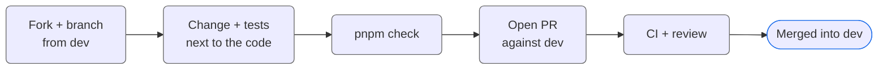

<!--suppress HtmlDeprecatedAttribute -->
<h1 align="center">Contributing</h1>

  <h6>
    <a rel="noopener noreferrer" href="README.md">Readme</a>
    ·
    <a rel="noopener noreferrer" href="CODE_OF_CONDUCT.md">Code of Conduct</a>
    ·
    <a rel="noopener noreferrer" href="SECURITY.md">Security Policy</a>
    ·
    <a rel="noopener noreferrer" href="SUPPORT.md">Support</a>
    ·
    <a rel="noopener noreferrer" href="RELEASING.md">Releasing</a>
    ·
    <a rel="noopener noreferrer" href="LICENSE.md">License</a>
  </h6>

Thank you for taking the time to contribute. Rhumb is maintained by
[Nykon Hrytsyshyn](https://nykon.me), and the project values **small, explicit
changes that keep the rendering core dependable**.

## Code of Conduct

All contributors are expected to follow the [Code of Conduct](CODE_OF_CONDUCT.md). 
Please be respectful, constructive and professional in all interactions.

## How to Contribute

### 🐞 Reporting Bugs

Open an issue with the **Bug Report** form and include:

- The smallest diagram source that shows the problem
- The selected profile (built-in id, or the custom profile JSON)
- Expected and actual result - a screenshot or the exported SVG helps a lot
- Browser, OS and, for local builds, Node and pnpm versions
- The exact error message, if there is one

Search existing issues before opening a new one.

### 💡 Suggesting Enhancements

Open an issue with the **Feature request** form and describe:

- The problem you are trying to solve, with a concrete example diagram
- How the idea maps to the standard block diagram model and to
  profile-controlled geometry
- Alternatives you considered

### 🔧 Submitting Pull Requests

1. Fork the repository and create a branch from `dev`
2. Make focused changes that follow the existing style and package boundaries
3. Add or update tests next to the affected implementation
4. Run `pnpm check` (typecheck, lint, format, tests and build)
5. Open a pull request **against `dev`**

> [!IMPORTANT]
> `release` is updated only by the automated release pull request. Never open a
> pull request against it - see [RELEASING.md](RELEASING.md).

## Development Guidelines

- Use the existing TypeScript, React, pnpm and design patterns
- Keep shared rendering logic out of `apps/web`
- Import other packages through their public entry point, never from their
  internal paths
- Prefer typed guards and existing domain types over type assertions
- Reject unsupported input explicitly - never produce a success-shaped
  approximation
- Keep comments for non-obvious decisions rather than narrating the code
- Avoid unrelated refactoring

## Pull Request Checklist

Describe **what** changed, **why** it changed and **how** it was verified.
Include a small source example for parser or rendering changes. UI changes
should name the relevant editor tab and export path.

Every pull request runs these checks, and all of them must pass:

| Check              | Covers                                        |
|--------------------|-----------------------------------------------|
| **CI: Quality**    | Typecheck, ESLint (with FSD rules), Prettier  |
| **CI: Test**       | The Vitest suite, with a coverage report      |
| **CI: Build**      | The production build                          |
| **CI: CodeQL**     | Security analysis of the code and workflows   |

## Review Process

- Maintainers may request changes or clarification
- Reviews focus on correctness, clarity and maintainability
- Approval does not guarantee an immediate merge
- A pull request may be declined if it does not fit the project's scope

## Licensing

By contributing, you agree that your contributions are licensed under the
[MIT License](LICENSE.md).

#

<h6 align="center">
  Thank you for contributing to Rhumb. 
  Small changes, clear scope, dependable output.
</h6>
