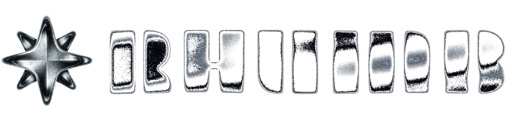
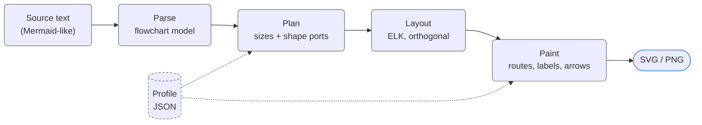
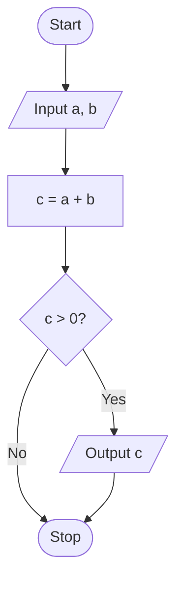
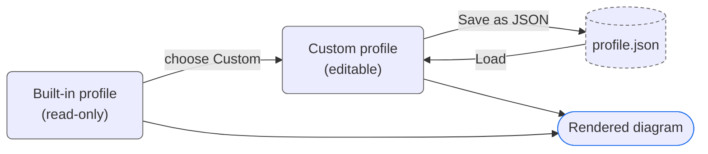
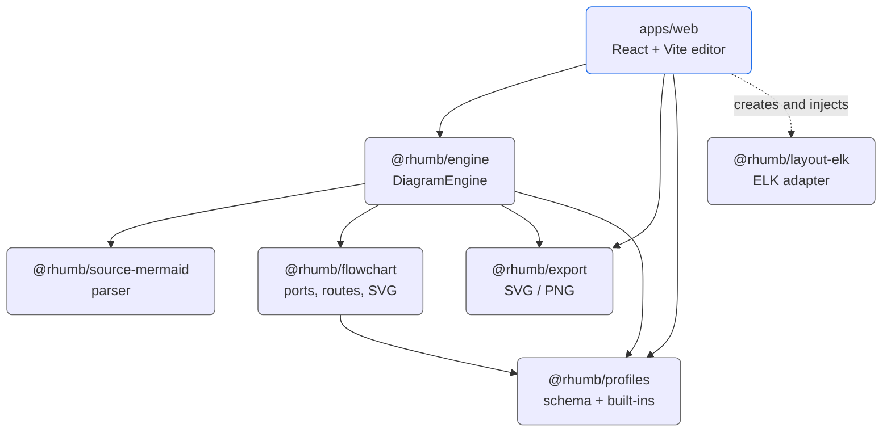
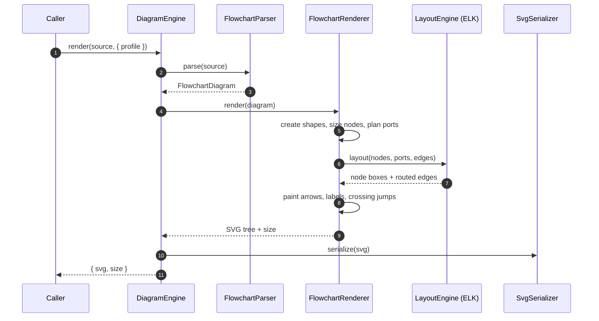
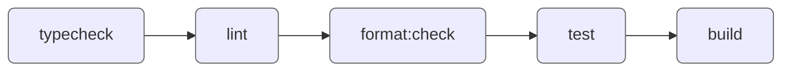

<!--suppress HtmlDeprecatedAttribute, HtmlUnknownTarget -->
<div align="center">
  <!--
  =====================
         HEADER
  =====================
  -->
  <a rel="noopener noreferrer" href="https://github.com/nykonhrytsyshyn/rhumb">
    <picture>
      <source media="(prefers-color-scheme: light)" srcset="./.github/assets/logo-text-light.png">
      
    </picture>
  </a>
  <br />
  <!--
  =====================
         BADGES
  =====================
  -->
  <div>
    <!-- Repo Stars Badge -->
    <a rel="noopener noreferrer" href="https://github.com/nykonhrytsyshyn/rhumb/stargazers">
      <picture>
        <source media="(prefers-color-scheme: light)" srcset="https://img.shields.io/github/stars/nykonhrytsyshyn/rhumb?style=for-the-badge&logo=starship&color=363636&labelColor=464646" />
        
      </picture>
    </a>
    <!-- Repo Contributors Badge -->
    <a rel="noopener noreferrer" href="https://github.com/nykonhrytsyshyn/rhumb/contributors">
      <picture>
        <source media="(prefers-color-scheme: light)" srcset="https://img.shields.io/github/contributors/nykonhrytsyshyn/rhumb?style=for-the-badge&logo=githubsponsors&logoColor=fff&color=363636&labelColor=464646" />
        
      </picture>
    </a>
    <!-- Repo Views Badge -->
    <a rel="noopener noreferrer" href="https://hits.sh/github.com/nykonhrytsyshyn/rhumb">
      <picture>
        <source media="(prefers-color-scheme: light)" srcset="https://hits.sh/github.com/nykonhrytsyshyn/rhumb.svg?style=for-the-badge&label=Views&logo=github&color=363636&labelColor=464646" />
        
      </picture>
    </a>
    <br />
    <!-- Version Badge -->
    <a rel="noopener noreferrer" href="https://github.com/nykonhrytsyshyn/rhumb/releases">
      <picture>
        <source media="(prefers-color-scheme: light)" srcset="https://img.shields.io/github/v/release/nykonhrytsyshyn/rhumb?style=for-the-badge&label=Version&color=363636&labelColor=464646&logo=data:image/svg%2bxml;base64,PHN2ZyB4bWxucz0iaHR0cDovL3d3dy53My5vcmcvMjAwMC9zdmciIHdpZHRoPSIxNiIgaGVpZ2h0PSIxNiI+PHBhdGggZmlsbD0iI2ZmZiIgZD0iTTEgNy44di01UTEuMiAxLjIgMi44IDFoNXEuNyAwIDEuMi41bDYuMyA2LjNhMiAyIDAgMCAxIDAgMi40bC01IDVhMiAyIDAgMCAxLTIuNSAwTDEuNSA5QTIgMiAwIDAgMSAxIDcuOG0xLjUgMFY4bDYuMyA2LjJoLjRsNS01di0uNEw4IDIuNmwtLjItLjFoLTVsLS4zLjNaTTYgNWExIDEgMCAxIDEgMCAyIDEgMSAwIDAgMSAwLTIiLz48L3N2Zz4=" />
        
      </picture>
    </a>
    <!-- License Badge -->
    <a rel="noopener noreferrer" href="LICENSE.md">
      <picture>
        <source media="(prefers-color-scheme: light)" srcset="https://img.shields.io/github/license/nykonhrytsyshyn/rhumb?style=for-the-badge&color=363636&labelColor=464646&logo=data:image/svg%2bxml;base64,PHN2ZyB4bWxucz0iaHR0cDovL3d3dy53My5vcmcvMjAwMC9zdmciIHdpZHRoPSIxNiIgaGVpZ2h0PSIxNiI+PHBhdGggZmlsbD0iI2ZmZiIgZD0iTTguOC44VjJoMXEuMyAwIC44LjJsMS4zLjhoMi40YS44LjggMCAwIDEgMCAxLjVoLS41TDE2IDkuMmExIDEgMCAwIDEtLjEuOGwtLjUtLjUuNS41di4xbC0uOC40cS0uNi41LTIgLjVhNSA1IDAgMCAxLTItLjVsLS43LS40YTEgMSAwIDAgMS0uMi0xbDItNC42cS0uNiAwLTEtLjJMMTAgMy41SDguN1YxM2gyLjZhLjguOCAwIDAgMSAwIDEuNUg0LjhhLjguOCAwIDAgMSAwLTEuNWgyLjVWMy41SDZMNSA0LjNsLTEgLjIgMiA0LjdhMSAxIDAgMCAxLS4xLjhsLS41LS41LjUuNXYuMWwtLjguNHEtLjYuNS0yIC41YTUgNSAwIDAgMS0yLS41bC0uNy0uNEExIDEgMCAwIDEgMCA5bDItNC42aC0uNGEuOC44IDAgMCAxIDAtMS41aDIuNGwxLjMtLjguOS0uMmgxVi44YS44LjggMCAwIDEgMS41IDBtMi45IDguNHEuNC4zIDEuMy4zYy45IDAgMS0uMSAxLjMtLjNMMTMgNi4zWm0tMTAgMHEuNC4zIDEuMy4zYy45IDAgMS0uMSAxLjMtLjNMMyA2LjNaIi8+PC9zdmc+" />
        
      </picture>
    </a>
  </div>
  <h1></h1>
  <!--
  =====================
         SOURCES
  =====================
  -->
  <h6>
    <a rel="noopener noreferrer" href="CODE_OF_CONDUCT.md">Code of Conduct</a>
    ·
    <a rel="noopener noreferrer" href="CONTRIBUTING.md">Contributing</a>
    ·
    <a rel="noopener noreferrer" href="SECURITY.md">Security Policy</a>
    ·
    <a rel="noopener noreferrer" href="SUPPORT.md">Support</a>
    ·
    <a rel="noopener noreferrer" href="RELEASING.md">Releasing</a>
    ·
    <a rel="noopener noreferrer" href="LICENSE.md">License</a>
  </h6>
</div>

<div align="justify">
  <!--
  =====================
       DESCRIPTION
  =====================
  -->
  <p>
    Rhumb draws flowcharts from Mermaid-like text, the way standards require
    them to look. Write a few lines of plain text and get a publication-ready
    SVG with exact port connections, orthogonal routing and geometry taken from
    a validated profile.
  </p>
</div>

<div align="center">
  <h2 id="overview">Overview</h2>
</div>

Mermaid is excellent for sketching a graph quickly. Rhumb is for the next step:
flowcharts that need **predictable geometry, explicit block semantics and
repeatable output** - the kind that goes into a thesis, a specification or an
engineering document.

| Idea                      | What it means in practice                                                                                                          |
|---------------------------|------------------------------------------------------------------------------------------------------------------------------------|
| **Text in, diagram out**  | Write a small Mermaid-like flowchart and get a routed SVG                                                                          |
| **Standards as profiles** | Dimensions, line widths, typography, arrows, branch sides and routing around preparation blocks come from a validated JSON profile |
| **Browser-first**         | The editor is a static web app; your source, current diagram and saved library never leave the browser                             |
| **Useful exports**        | Download SVG or PNG, copy the rendered image, or download the source and a profile for reuse                                       |
| **Strict on purpose**     | Unsupported syntax is rejected with a line-numbered error instead of producing an approximate drawing                              |



<div align="center">
  <h2 id="editor">Try it in the browser</h2>
</div>

The hosted editor lives at **[rhumb.nykon.me](https://rhumb.nykon.me)**. It
opens with a working algorithm example.

| Tab        | What it does                                                             |
|------------|--------------------------------------------------------------------------|
| **Code**   | Edit the source, pick examples and export the current diagram            |
| **Saved**  | Keep named diagrams in the browser (IndexedDB) and reopen them later     |
| **Docs**   | Read the supported source syntax without leaving the editor              |
| **Config** | Select a built-in standard, tune a custom profile, import or export JSON |

> [!NOTE]
> There is no server-side workspace and no account. Clearing your browser's site
> data also clears the saved library - download the source of anything you want
> to keep.

<div align="center">
  <h2 id="quick-start">Quick Start</h2>
</div>

<h3 id="run-locally">
  Run the editor locally
</h3>

| Requirement | Version     |
|-------------|-------------|
| Node.js     | `>=22.16.0` |
| pnpm        | `>=11.0.0`  |

```bash
git clone https://github.com/nykonhrytsyshyn/rhumb.git
cd rhumb
pnpm install
pnpm run dev
```

Open the local URL printed by Vite. For a production-like preview (build, then
serve) use:

```bash
pnpm run staging
```

<h3 id="render-from-code">
  Render from code
</h3>

The rendering pipeline is split into packages, so it can be embedded without the
React application. The layout engine is injected, which keeps the core free of
any particular layout library:

```ts
import { ELK } from "elkjs";

import { DiagramEngine } from "@rhumb/engine";
import { ElkLayoutEngine } from "@rhumb/layout-elk";
import { ProfileRegistry } from "@rhumb/profiles";

const profile = ProfileRegistry.withBuiltins().get("iso-5807");
const engine = new DiagramEngine({
  layoutEngine: new ElkLayoutEngine(new ELK()),
});

const result = await engine.render(
  `flowchart LR
    start(["Start"]) --> input[/"Input x"/]
    input --> check{"x > 0?"}
    check -->|Yes| output[/"Output x"/]
    check -->|No| error["Report an error"]`,
  { profile },
);

console.log(result.size);
console.log(result.svg);
```

`render` also accepts `scale` (pixels per millimetre of the profile, `4` by
default) and `appearance` (colours; the print appearance is the default). It
throws a `DiagramSyntaxError` that carries the offending line number.

<div align="center">
  <h2 id="syntax">Source Syntax</h2>
</div>

Rhumb implements the flowchart subset that maps to standard block diagrams.
Start with `flowchart` (or `graph`), optionally followed by a direction:

| Direction   | Flow                    |
|-------------|-------------------------|
| `TD` / `TB` | Top to bottom (default) |
| `BT`        | Bottom to top           |
| `LR`        | Left to right           |
| `RL`        | Right to left           |

```text
flowchart TD
  start(["Start"]) --> read[/"Input a, b"/]
  read --> calculate["c = a + b"]
  calculate --> check{"c > 0?"}
  check -->|Yes| output[/"Output c"/]
  check -->|No| stop(["Stop"])
  output --> stop
```

GitHub draws that same source with plain Mermaid:



Rhumb draws it from the selected profile instead - exact block sizes, grid, line
widths and port connections.

<h3 id="blocks">
  Blocks
</h3>

| Syntax                           | Block                     |
|----------------------------------|---------------------------|
| `A[text]`                        | Process                   |
| `A([text])` or `A(text)`         | Terminator                |
| `A{text}`                        | Decision                  |
| `A[/text/]` or `A[\text\]`       | Input / output            |
| `A{{text}}`                      | Preparation               |
| `A[[text]]`                      | Predefined process        |
| `A((text))`                      | Connector                 |
| `A[)text(]`                      | Stored data               |
| `A[#text#]`                      | Internal storage          |
| `A(@text@)`                      | Sequential-access storage |
| `A[(text)]`                      | Direct-access storage     |
| `A[~text~]`                      | Document                  |
| `A[~~text~~]`                    | Paper tape                |
| `A[^text^]`                      | Manual input              |
| `A[:text:]`                      | Card                      |
| `A(=text=)`                      | Display                   |
| `A[\text/]`                      | Manual operation          |
| `A[=]`                           | Parallel actions          |
| `A{^name: text^}`                | Loop limit, start         |
| `A{_name_}` or `A{_name: text_}` | Loop limit, end           |
| `A(>P>)`                         | Transfer of control       |
| `A[*text*]`                      | Comment                   |

Every block has a short form. A short form counts only when it is closed:
`A[~x]` is a process whose text is `~x`, and putting the text in quotes
(`A["~x~"]`) always gives a process.

Node identifiers may contain Unicode letters, numbers and underscores. Labels
support `<br>` and `\n` for line breaks. Statements are separated by newlines or
semicolons, and `%%` starts a comment that runs to the end of the line; both are
ignored inside quotes.

<h3 id="shapes">
  Blocks by name
</h3>

Mermaid's own syntax for shapes works too, so a source that uses it stays valid
for GitHub: `A@{ shape: doc, label: "Report" }`. The braces may run over several
lines. Besides the names Mermaid defines (`rect`, `stadium`, `fr-rect`, `diam`,
`hex`, `lean-r`, `circ`, `bow-rect`, `win-pane`, `h-cyl`, `doc`, `docs`, `flag`,
`sl-rect`, `notch-rect`, `curv-trap`, `trap-t`, `fork`, `notch-pent`, `tri`,
`bolt`, `brace`, `st-rect`, `div-rect` and their aliases) Rhumb accepts
`seq-store`, `loop-start` and `loop-end`. A shape that is not a block of the
standard is an error. Blocks Rhumb names itself (`seq-store`, `loop-start`,
`loop-end`) are not known to Mermaid, so GitHub will not draw a source that
uses them.

The same braces carry properties, in a short form or on their own:

| Property          | Effect                                                              |
|-------------------|---------------------------------------------------------------------|
| `shape`, `label`  | The block's shape and text                                          |
| `ident: "P1"`     | Identifier above the block, on the left (ISO 5807, 4.1.5)           |
| `desc: "text"`    | Description above the block, on the right (4.1.6, 4.1.7)            |
| `input: "text"`   | Description below the block, on the right, for inputs (4.1.7)       |
| `ref: "X84"`      | Stripe with a reference to a detailed sheet (4.1.8)                 |
| `stack: 3`        | Overlapping copies of the block, 2 to 8 (4.3.2)                     |
| `loop: "i"`       | Name that joins the two loop limits                                 |
| `side: left`      | Side of a comment: `right`, `left`, `top` or `bottom`               |
| `legend: "text"`  | What the letter of a transfer of control stands for                 |

`A[Text] @{ ref: "X84" }` and `A@{ ref: "X84" }` on an existing block both work;
the new values are merged into the block.

<h3 id="frames">
  Frames, comments, loops and omissions
</h3>

```text
flowchart TD
  a[/"Input A"/] --> one
  subgraph part [" "]
    one["Process 1"] --> two["Process 2"]
  end
  note[*"Runs once"*] -.- part
  two --> done(["End"])
```

- `subgraph name ["Title"]` ... `end` draws a dashed frame around the blocks
  named inside it. Frames nest. A frame has a title only when you give one. A
  block belongs to the frame it is first named in.
- A comment is linked to one block or one frame. Its link is always dashed and
  has no arrow; the comment is placed beside the block, on the side that is free.
- The two parts of a loop limit are paired by their name: the text before the
  first colon, or the `loop` property. Every start needs an end of the same name.
- A line labelled `...` shows the omission symbol instead of the label, and a
  line labelled `~` shows the communication-link symbol (a zigzag) in its middle.
  Both are line symbols, so they carry no other label.

<h3 id="links">
  Links
</h3>

| Syntax              | Line                  |
|---------------------|-----------------------|
| `A --> B`           | Solid, with an arrow  |
| `A --- B`           | Solid, no arrow       |
| `A -.-> B`          | Dashed, with an arrow |
| `A ==> B`           | Thick, with an arrow  |
| `A -->\|Yes\| B`    | Inline label          |
| `A -- retry --> B`  | Labelled link         |

Chains work as in Mermaid: `A --> B --> C` is two links. Decision labels such as
`Yes` and `No` are matched against the profile (case-insensitively) to choose
consistent branch sides.

<div align="center">
  <h2 id="profiles">Standards and Profiles</h2>
</div>

A profile is a validated JSON document that describes every measurable part of a
diagram. All lengths are in millimetres.

| Built-in profile   | Id               | Notes               |
|--------------------|------------------|---------------------|
| **ISO 5807**       | `iso-5807`       | The default profile |
| **GOST 19.701-90** | `gost-19.701-90` |                     |

| Section           | Controls                                                                                            |
|-------------------|-----------------------------------------------------------------------------------------------------|
| `grid`, `padding` | The drawing grid and the gap between a block's border and its text                                  |
| `spacing`         | Distance between blocks and layers, clearance around blocks                                         |
| `line`            | Line and thick-line widths, dash pattern, label style (beside / inline), crossing jumps, arrowheads |
| `font`            | Family, size and line height                                                                        |
| `shapes`          | Minimum width and height of every block kind                                                        |
| `decision`        | The side a decision is entered from and where its `yes` / `no` branches leave                       |
| `preparation`     | Entry, repeat, return and exit sides of a preparation block that the flow returns to                |

Validation catches impossible profiles early: a decision's entry, `yes` and `no`
sides must be able to differ, and so must the four sides of a preparation block.
A side is `top`, `right`, `bottom` or `left`, or an open choice that Rhumb
settles for each diagram: `side` means left or right and `vertical` means top
or bottom, so two open choices can share a pair. A branch that returns to a
preparation block takes the side that block receives returning lines on.
Built-in profiles are read-only in the editor - choose **Custom** to change
values.



<div align="center">
  <h2 id="architecture">Architecture</h2>
</div>

Rhumb is a small TypeScript monorepo: a browser editor on top of a
standard-aware rendering core. The stages are separate packages, so the parser,
geometry, layout and export can be tested independently.



Every package builds on **`@rhumb/kernel`** (shared model, geometry and
contracts), which is why it is left out of the graph. The core is independent of
React and browser storage: `DiagramEngine` receives its `LayoutEngine` from the
caller, and the web app supplies the ELK implementation.

<h3 id="render-flow">
  What happens during a render
</h3>



<h3 id="packages">
  Packages
</h3>

| Package                                            | Responsibility                                                                                                          |
|----------------------------------------------------|-------------------------------------------------------------------------------------------------------------------------|
| [`@rhumb/kernel`](packages/kernel)                 | Diagram models, geometry, directions, layout contracts, text measurement and syntax errors                              |
| [`@rhumb/source-mermaid`](packages/source-mermaid) | Line-aware parser for the supported Mermaid-like flowchart subset                                                       |
| [`@rhumb/profiles`](packages/profiles)             | Validated JSON profile schema, registry and built-in profiles                                                           |
| [`@rhumb/layout-elk`](packages/layout-elk)         | Adapter between Rhumb's `LayoutEngine` contract and ELK's layered, orthogonal layout                                    |
| [`@rhumb/flowchart`](packages/flowchart)           | Standard-aware shapes, text placement, port planning, edge routes, decision branches, preparation returns and crossings |
| [`@rhumb/export`](packages/export)                 | Deterministic SVG serialization and browser PNG export primitives                                                       |
| [`@rhumb/engine`](packages/engine)                 | The high-level `DiagramEngine` that connects all stages                                                                 |
| [`apps/web`](apps/web)                             | React/Vite editor: persistence, profile editing, language and theme, export actions                                     |

<div align="center">
  <h2 id="development">Development</h2>
</div>

In the editor's Config tab, the **Other** section holds the **Developer mode**
switch. It shows what is meant for working on Rhumb itself, such as the test
diagrams; it is always on in the development build and off elsewhere until you
turn it on.

Run everything from the repository root:

| Command             | What it does                                                                  |
|---------------------|-------------------------------------------------------------------------------|
| `pnpm dev`          | Start the web editor                                                          |
| `pnpm staging`      | Build, then serve a production-like preview                                   |
| `pnpm build`        | Type-check and build the web app                                              |
| `pnpm preview`      | Serve the last build of the web app                                           |
| `pnpm check`        | The complete verification pipeline                                            |
| `pnpm typecheck`    | Type-check every workspace package                                            |
| `pnpm lint`         | ESLint and Feature-Sliced checks                                              |
| `pnpm test`         | Run the Vitest suite (`test:watch`, `test:coverage` and `test:ui` also exist) |
| `pnpm format`       | Format the code with Prettier                                                 |
| `pnpm format:check` | Verify Prettier formatting                                                    |
| `pnpm deps`         | Update dependencies                                                           |
| `pnpm deps:check`   | Check for outdated dependencies                                               |
| `pnpm tree`         | Show the project's file tree                                                  |
| `pnpm tree:export`  | Export the file tree to a file                                                |



The project uses TypeScript, React, Vite, Vitest, ELK and pnpm workspaces. Tests
live next to the implementation and cover the parser, layout, exporter,
profiles, state and UI. The same checks run in CI on every pull request.

Contributions should stay focused, preserve the package boundaries and include
tests for behavior changes. See [CONTRIBUTING.md](CONTRIBUTING.md).

<div align="center">
  <h2 id="releases">Releases</h2>
</div>

Rhumb uses **calendar versioning**: `YY.M.N` - year, month and the build number
inside that month (for example `26.10.5`). A release is a verified repository
state with a git tag and a GitHub Release.
Branches, the automated release PR described in [RELEASING.md](RELEASING.md).

<h6>
  <div align="center">
    • • •
    <br /><br />
    This project is licensed under the <a rel="noopener noreferrer" href="./LICENSE.md">MIT License</a>
    <br /><br />
  </div>
  <div align="justify">
    <ul>
      <li>Feel free to use this project for any purpose, including commercial applications.</li>
      <li>You are permitted to modify, distribute, and include this project in any form, as long as the original copyright notice is retained.</li>
      <li>If you share or publish modified versions, attribution to the original <a rel="noopener noreferrer" href="https://github.com/nykonhrytsyshyn/rhumb">GitHub repository</a> is appreciated.</li>
      <li>This software is provided "as is", without any warranties or guarantees, as detailed in the license terms.</li>
    </ul>
  </div>
</h6>
