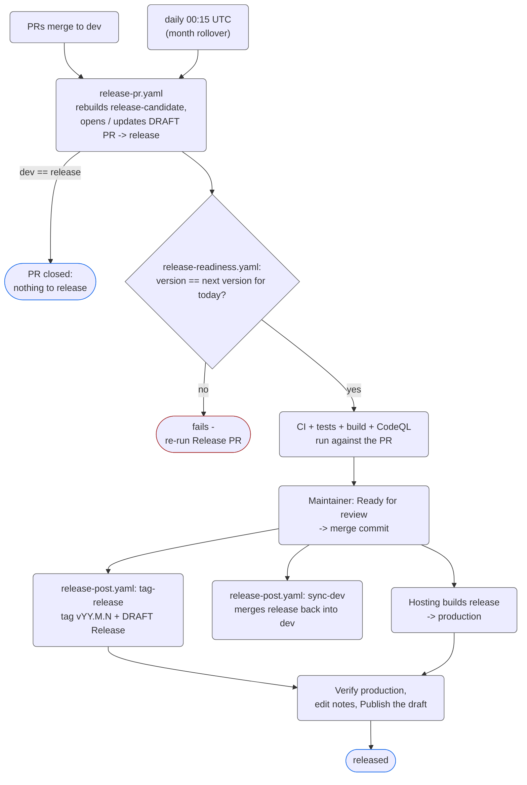

<!--suppress HtmlDeprecatedAttribute, HtmlUnknownTarget -->
<h1 id="title" align="center">Releasing</h1>

<div align="center">
  <h6>
    <a rel="noopener noreferrer" href="README.md">Readme</a>
    ·
    <a rel="noopener noreferrer" href="CODE_OF_CONDUCT.md">Code of Conduct</a>
    ·
    <a rel="noopener noreferrer" href="CONTRIBUTING.md">Contributing</a>
    ·
    <a rel="noopener noreferrer" href="SECURITY.md">Security Policy</a>
    ·
    <a rel="noopener noreferrer" href="SUPPORT.md">Support</a>
    ·
    <a rel="noopener noreferrer" href="LICENSE.md">License</a>
  </h6>
</div>

A release is a **verified repository state, a git tag and a GitHub Release**;
the site itself goes live when the hosting provider builds the `release` branch.
Two long-lived branches carry the flow: `dev` (where all development happens)
and `release` (the tip of the last shipped release).

<div align="center">
  <h2 id="overview">Overview</h2>
</div>

| Concept                  | Description                                                                                                                                                                                                              |
|--------------------------|--------------------------------------------------------------------------------------------------------------------------------------------------------------------------------------------------------------------------|
| **Calendar version**     | `YY.M.N` - year, month, build number inside that month, e.g. `26.10.5`. Every `package.json` in the workspace carries the same version; the git tag is the same string with a `v` prefix - see [Versioning](#versioning) |
| **Release PR**           | A **draft** PR `release-candidate` -> `release`, labeled `Release` and `Automated`, maintained by `release-pr.yaml`. It is `dev`'s current HEAD plus one commit that sets the next version in all manifests              |
| **Version Gate**         | `release-readiness.yaml` fails the PR unless its version is exactly the one that would be issued right now (right month, higher than every existing tag). CI, tests, build and CodeQL run against the PR as usual        |
| **Confirmation**         | Marking the PR **Ready for review** and merging it (merge commit). This is the human decision to ship                                                                                                                    |
| **Tag & draft release**  | Created by `release-post.yaml` the moment the merge lands on `release`: annotated tag `vYY.M.N` and a **draft** GitHub Release with generated notes                                                                      |
| **Publishing the draft** | The final, optional-to-automate step: after checking production, edit the notes and click **Publish** on the draft. Nothing is triggered by it - it only makes the release public                                        |

<div align="center">
  <h2 id="versioning">Versioning</h2>
</div>

```text
YY.M.N
│  │ └─ build number inside this year + month, starts at 1
│  └─── month 1..12, no leading zero
└────── last two digits of the year
```

| Date (UTC)  | Latest known | Next release |
|-------------|--------------|--------------|
| 2026-10-16  | none         | `26.10.1`    |
| 2026-10-20  | `26.10.1`    | `26.10.2`    |
| 2026-10-31  | `26.10.5`    | `26.10.6`    |
| 2026-11-02  | `26.10.6`    | `26.11.1`    |
| 2027-01-04  | `26.12.3`    | `27.1.1`     |

- The month and year are always taken in **UTC**.
- The **latest known** version is the highest of: every `vYY.M.N` tag, and the
  version in `package.json` on `release`. Tags and branch together mean a
  half-failed release (tag without merge, merge without tag) never gets its
  number reused. Tags that don't parse as `YY.M.N` are ignored.
- Versions are comparable year -> month -> build, so `26.10.12` > `26.10.9`.
  Numbers are not zero-padded, so sort tags with `--sort=-version:refname`, not
  alphabetically.

### A release PR that sits open over a month boundary

A PR can easily wait for days. The rule that keeps this simple: **the release PR
is never edited, only rebuilt**, and its version is always recomputed from
scratch for *today*:

1. `release-pr.yaml` runs on every push to `dev` **and once a day** (00:15 UTC).
   On the 1st of a new month it computes `YY.M+1.1`, force-pushes a fresh
   `release-candidate`, retitles the PR and moves it back to draft.
2. `release-readiness.yaml` re-checks on every push to the PR **and when it is
   marked Ready for review**. If the month changed in between, the gate fails
   with the expected version, instead of letting an October build ship as
   `26.10.x` in November.
3. If you hit the gate in the gap before the daily run, start **Releasing:
   Release PR** manually (Actions -> Run workflow) - it takes a few seconds.

<div align="center">
  <h2 id="how-a-release-actually-happens">How a release actually happens</h2>
</div>



1. Land changes. PRs merge to `dev` as usual; no per-PR release files are
   needed.
2. `release-pr.yaml` keeps one draft **Release vYY.M.N** PR against `release`.
   Its body lists the commits since the last release. If `dev` and `release`
   have identical trees, there is nothing to release and the PR is closed.
3. Review it. Any later change to the candidate (new commit on `dev`, new
   version) moves the PR **back to draft** and comments - so *Ready for review*
   always refers to what you actually looked at.
4. Mark **Ready for review**, wait for green checks (including the Version
   Gate), and merge with a **merge commit**.
5. `release-post.yaml` fires on the push to `release`, in two parallel jobs:
   - `tag-release` reads the version (failing if manifests disagree), skips if
     the tag already exists, otherwise pushes annotated tag `vYY.M.N` and opens
     a **draft** GitHub Release - generated notes grouped by PR label (see
     [`.github/release.yaml`](.github/release.yaml)) plus a "Known limitations"
     stub. Every step is idempotent: re-run the job if it failed halfway.
   - `sync-dev` merges `release` into `dev`. Normally this is a fast-forward,
     so `dev` and `release` become identical and the cycle starts over.
6. Run the [post-release checks](#post-release-checks) against production.
7. Edit the draft's notes, fill in or delete *Known limitations*, and click
   **Publish**.

> [!IMPORTANT]
> `release` must only ever move through the release PR. `release-pr.yaml` stops
> with an error if `release` holds commits that `dev` lacks (e.g. a failed
> `sync-dev`), because merging the candidate would silently drop them.

<div align="center">
  <h2 id="post-release-checks">Post-release checks</h2>
</div>

Before publishing the draft, verify the deployed editor manually:

- load the default sample;
- render a custom diagram;
- switch language and theme;
- export SVG and PNG;
- load and download a profile;
- save and reopen a diagram.

Keep the release notes honest: list known limitations, and do not describe draft
profile values as formal standards certification.

<div align="center">
  <h2>Commands</h2>
</div>

Everything runs from the repository root.

| Command                                              | What it does                                                                                                  |
|------------------------------------------------------|---------------------------------------------------------------------------------------------------------------|
| `node .github/scripts/release.ts next`               | Print the version the next release would get (reads tags + `origin/release`; `--date YYYY-MM-DD` to simulate) |
| `node .github/scripts/release.ts current`            | Print the workspace version; fails if manifests disagree or it isn't `YY.M.N`                                 |
| `node .github/scripts/release.ts verify`             | The Version Gate, locally                                                                                     |
| `node .github/scripts/release.ts bump <version>`     | Write a version into every manifest - CI does this, you normally never should                                 |
| `node .github/scripts/release.ts previous <version>` | Print the highest released tag below `<version>`                                                              |
| `pnpm run check`                                     | Full local verification: typecheck, lint, format, tests, build                                                |

To refresh the release PR on demand: **Actions -> Releasing: Release PR -> Run
workflow** on `dev`.

<div align="center">
  <h2>Workflows</h2>
</div>

| Workflow                 | Trigger                               | Purpose                                               |
|--------------------------|---------------------------------------|-------------------------------------------------------|
| `ci-quality.yaml`        | push / PR to `dev`, `release`         | Typecheck, ESLint + FSD lint, Prettier                |
| `ci-test.yaml`           | push / PR to `dev`, `release`         | Vitest; coverage comment on PRs                       |
| `ci-build.yaml`          | push / PR to `dev`, `release`         | Production build (tsc + vite + PWA)                   |
| `ci-codeql.yaml`         | push / PR to `dev`, `release`, weekly | CodeQL for JS/TS and for the workflow files           |
| `release-pr.yaml`        | push to `dev`, daily, manual          | Rebuilds `release-candidate` and the draft release PR |
| `release-readiness.yaml` | PR to `release`                       | Version Gate                                          |
| `release-post.yaml`      | push to `release`, manual             | Tag, draft GitHub Release, sync `release` into `dev`  |

CI workflows can be skipped with tags anywhere in the commit message or PR
title: `[ci-skip]` (all), `[quality-skip]`, `[test-skip]`, `[build-skip]`,
`[ql-skip]`. The release workflows deliberately ignore skip tags, so releases
can't be stalled by accident.

<h6 align="center">
  Small releases, verified behavior, boring rollbacks.
</h6>
