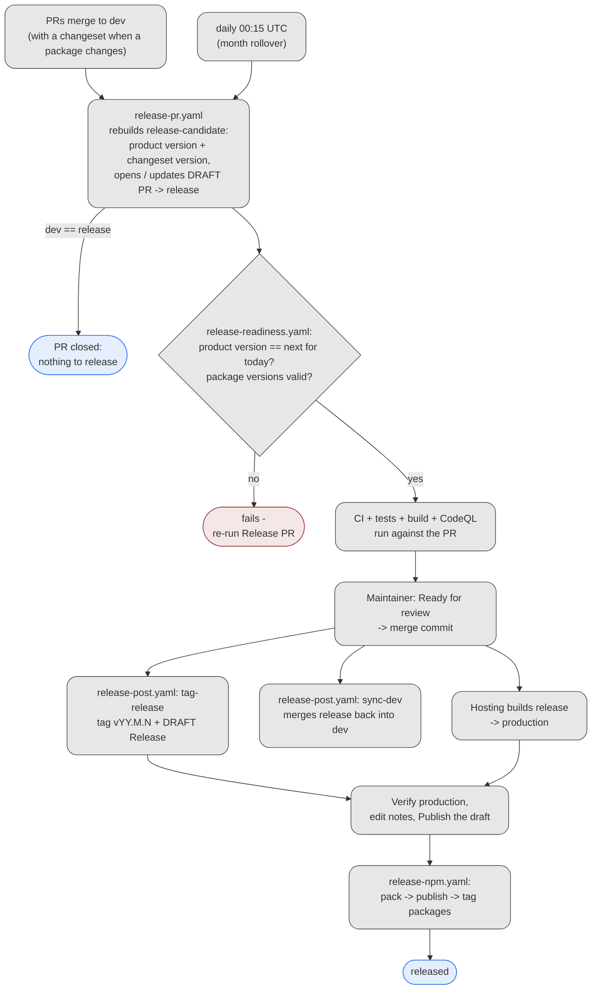

<!--suppress HtmlDeprecatedAttribute, HtmlUnknownTarget -->
<h1 id="title" align="center">Releasing</h1>

<div align="center">
  <h6>
    <a rel="noopener noreferrer" href="README.md">Readme</a>
    ·
    <a rel="noopener noreferrer" href="CODE_OF_CONDUCT.md">Code of Conduct</a>
    ·
    <a rel="noopener noreferrer" href="CONTRIBUTING.md">Contributing</a>
    ·
    <a rel="noopener noreferrer" href="SECURITY.md">Security Policy</a>
    ·
    <a rel="noopener noreferrer" href="SUPPORT.md">Support</a>
    ·
    <a rel="noopener noreferrer" href="LICENSE.md">License</a>
  </h6>
</div>

A release is a **verified repository state, a git tag and a GitHub Release**;
the site itself goes live when the hosting provider builds the `release` branch.
Two long-lived branches carry the flow: `dev` (where all development happens)
and `release` (the tip of the last shipped release).

The repository ships two different things, and they are versioned differently:

- the **product** - the site and the repository - with a calendar version;
- the **npm packages** `@nykon/rhumb` and `@nykon/rhumb-cli` with SemVer, each
  on its own, because that is what npm consumers (and their tooling) expect.

<div align="center">
  <h2 id="overview">Overview</h2>
</div>

| Concept                  | Description                                                                                                                                                                                                                                                       |
|--------------------------|-------------------------------------------------------------------------------------------------------------------------------------------------------------------------------------------------------------------------------------------------------------------|
| **Product version**      | Calendar version `YY.M.N`, e.g. `26.10.5`. Carried by the root and every **private** `package.json`; the git tag is the same string with a `v` prefix - see [Versioning](#versioning)                                                                             |
| **Package version**      | SemVer (`0.1.0`, `1.4.2`), one per public package, written by changesets. Tagged `<name>@<version>`, e.g. `@nykon/rhumb@0.1.0`, **after** it is on npm                                                                                                            |
| **Changeset**            | A small file in `.changeset/` that names the public packages a change affects, the bump and one line of text - see [Changesets](#changesets). No changeset, no package release                                                                                    |
| **Release PR**           | A **draft** PR `release-candidate` -> `release`, labeled `Release` and `Automated`, maintained by `release-pr.yaml`. It is `dev`'s current HEAD plus one commit that sets the product version and consumes the pending changesets                                 |
| **Readiness Gate**       | `release-readiness.yaml` fails the PR unless the product version is exactly the one that would be issued right now, and every package version is valid, forward-moving and has a changelog entry. CI, tests, build and CodeQL run against the PR as usual         |
| **Confirmation**         | Marking the PR **Ready for review** and merging it (merge commit). This is the human decision to ship                                                                                                                                                             |
| **Tag & draft release**  | Created by `release-post.yaml` the moment the merge lands on `release`: annotated tag `vYY.M.N` and a **draft** GitHub Release with generated notes and the list of npm packages it will publish                                                                  |
| **Publishing the draft** | The final human step: after checking production, edit the notes and click **Publish** on the draft. This makes the release public and starts `release-npm.yaml`, which publishes the packages that have a new version - see [The npm packages](#the-npm-packages) |

<div align="center">
  <h2 id="versioning">Versioning</h2>
</div>

|                | Product                                     | npm packages                                     |
|----------------|---------------------------------------------|--------------------------------------------------|
| Scheme         | CalVer `YY.M.N`                             | SemVer, per package                              |
| Written by     | `release.ts bump` in the release PR         | `changeset version` in the release PR            |
| Lives in       | root and **private** `package.json` files   | each public `package.json` + its `CHANGELOG.md`  |
| Git tag        | `v26.11.4`, made when the release PR merges | `@nykon/rhumb@0.1.0`, made after the npm publish |
| GitHub Release | `Rhumb v26.11.4`, **Latest**                | `@nykon/rhumb 0.1.0`, **not** Latest             |
| Moves when     | every release                               | only when a changeset names the package          |

Because they are separate, a release of the website alone does not touch npm, and
versions on npm never have to look like a date.

### Product version: CalVer

```text
YY.M.N
│  │ └─ build number inside this year + month, starts at 1
│  └─── month 1..12, no leading zero
└────── last two digits of the year
```

| Date (UTC)  | Latest known | Next release |
|-------------|--------------|--------------|
| 2026-10-16  | none         | `26.10.1`    |
| 2026-10-20  | `26.10.1`    | `26.10.2`    |
| 2026-10-31  | `26.10.5`    | `26.10.6`    |
| 2026-11-02  | `26.10.6`    | `26.11.1`    |
| 2027-01-04  | `26.12.3`    | `27.1.1`     |

- The month and year are always taken in **UTC**.
- The **latest known** version is the highest of: every `vYY.M.N` tag, and the
  version in `package.json` on `release`. Tags and branch together mean a
  half-failed release (tag without merge, merge without tag) never gets its
  number reused. Tags that don't parse as `YY.M.N` are ignored - which is why
  the package tags (`@nykon/rhumb@0.1.0`) cannot disturb it.
- Versions are comparable year -> month -> build, so `26.10.12` > `26.10.9`.
  Numbers are not zero-padded, so sort tags with `--sort=-version:refname`, not
  alphabetically.

#### A release PR that sits open over a month boundary

A PR can easily wait for days. The rule that keeps this simple: **the release PR
is never edited, only rebuilt**, and its version is always recomputed from
scratch for *today*:

1. `release-pr.yaml` runs on every push to `dev` **and once a day** (00:15 UTC).
   On the 1st of a new month it computes `YY.M+1.1`, force-pushes a fresh
   `release-candidate`, retitles the PR and moves it back to draft.
2. `release-readiness.yaml` re-checks on every push to the PR **and when it is
   marked Ready for review**. If the month changed in between, the gate fails
   with the expected version, instead of letting an October build ship as
   `26.10.x` in November.
3. If you hit the gate in the gap before the daily run, start **Releasing:
   Release PR** manually (Actions -> Run workflow) - it takes a few seconds.

### Package versions: SemVer

Each public package has its own version and its own `CHANGELOG.md`.

- **Start.** A package that was never released sits at `0.0.0` - the placeholder
  that is never published. Its first changeset (`minor`) makes it `0.1.0`.
- **While `0.x`** the API is not stable: a breaking change is a `minor`.
  `1.0.0` is a deliberate decision, made with a `major` changeset once the API
  is something to commit to.
- **Tags** `<name>@<version>` are created by `release-npm.yaml` after a
  successful publish. "Has no tag" therefore means "not published yet", and that
  is exactly how the tooling decides what is pending: a version without a tag
  is pending, a version older than the latest tag is an error.
- **Independent.** The library may be at `0.4.1` while the CLI is at `0.2.0`.
  The CLI *bundles* the library, so a library change always comes with a CLI
  entry - see [Bundled packages](#bundled-packages).

<div align="center">
  <h2 id="how-a-release-actually-happens">How a release actually happens</h2>
</div>



1. Land changes. PRs merge to `dev` as usual. A change that reaches a public
   package carries a [changeset](#changesets); `CI: Changeset` enforces it.
2. `release-pr.yaml` keeps one draft **Release vYY.M.N** PR against `release`.
   Its body lists the commits since the last release and the **npm packages**
   the release will publish. If `dev` and `release` have identical trees, there
   is nothing to release and the PR is closed.
3. Review it. Look at the `package.json` and `CHANGELOG.md` diffs of the public
   packages: that is exactly what will go to npm. Any later change to the
   candidate (new commit on `dev`, new version) moves the PR **back to draft**
   and comments - so *Ready for review* always refers to what you looked at.
4. Mark **Ready for review**, wait for green checks (including the Readiness
   Gate), and merge with a **merge commit**.
5. `release-post.yaml` fires on the push to `release`, in two parallel jobs:
   - `tag-release` reads the product version (failing if manifests disagree),
     skips if the tag already exists, otherwise pushes annotated tag
     `vYY.M.N` and opens a **draft** GitHub Release - generated notes grouped by
     PR label (see [`.github/release.yaml`](.github/release.yaml)), the list of
     npm packages and a "Known limitations" stub. Every step is idempotent:
     re-run the job if it failed halfway.
   - `sync-dev` merges `release` into `dev`. Normally this is a fast-forward,
     so `dev` and `release` become identical and the cycle starts over.
6. Run the [post-release checks](#post-release-checks) against production.
7. Edit the draft's notes, fill in or delete *Known limitations*, and click
   **Publish**. This starts `release-npm.yaml` ([details](#the-npm-packages)).

> [!IMPORTANT]
> `release` must only ever move through the release PR. `release-pr.yaml` stops
> with an error if `release` holds commits that `dev` lacks (e.g. a failed
> `sync-dev`), because merging the candidate would silently drop them.

<div align="center">
  <h2 id="changesets">Changesets</h2>
</div>

A changeset says **which public package a change affects, by how much, and what
to tell its users**. It is a Markdown file in [`.changeset/`](.changeset), made
with [`@changesets/cli`](https://github.com/changesets/changesets) and committed
together with the change:

```bash
pnpm changeset       # interactive: pick the packages, the bump, write a line
pnpm changeset:empty # "this change needs no npm release"
```

```md
---
"@nykon/rhumb": minor
"@nykon/rhumb-cli": patch
---

Add the `gost` profile. The CLI picks it up through the bundled library.
```

The release PR consumes the files: each named package gets its new version and a
`CHANGELOG.md` entry, and the files are deleted. Changesets only ever touch the
two public packages - the site and the private packages keep the calendar
version and are excluded in [`.changeset/config.json`](.changeset/config.json).

| Bump    | When                                                                                    |
|---------|-----------------------------------------------------------------------------------------|
| `patch` | a fix or an internal change users can not tell apart                                    |
| `minor` | new behaviour, a new option, a new export (and, while `0.x`, a break)                   |
| `major` | a breaking change to the API, the CLI flags or its output (from `0.x`: this is `1.0.0`) |

### Bundled packages

`@nykon/rhumb-cli` contains a copy of `@nykon/rhumb` (and of the agent kit). A
fix in the library reaches CLI users only through a **new CLI release**. The
tool chain does not add that bump for you: `changeset version` ignores bundled
(`devDependencies`) packages, so the rule is enforced as a check instead.

### The pull request check

`CI: Changeset` (`ci-changeset.yaml`) runs on pull requests into `dev`.
It looks at which files changed and asks, for each public package, whether any
of them ships in it - the package itself or any workspace package bundled into
it, found through the dependency graph (so a new internal package is picked up
without touching the script).

| The pull request changes...                          | Needed                                           |
|------------------------------------------------------|--------------------------------------------------|
| only docs, tests, the website, toolchain packages    | nothing                                          |
| `packages/engine` (bundled into library **and** CLI) | a changeset naming **both** packages             |
| `apps/cli` only                                      | a changeset naming `@nykon/rhumb-cli`            |
| anything above, but no release is wanted             | `pnpm changeset --empty`                         |

Dependabot is exempt: its updates ship with the next release. Add a changeset by
hand for a dependency bump that must go out on its own (a security fix).
`[changeset-skip]` in the PR title skips the check.

```bash
node .github/scripts/packages.ts check --base origin/dev   # the same check, locally
```

<div align="center">
  <h2 id="the-npm-packages">The npm packages</h2>
</div>

Two packages are public; everything else in the workspace is private and is
bundled into them at build time.

| Package            | Where                            | What                                            |
|--------------------|----------------------------------|-------------------------------------------------|
| `@nykon/rhumb`     | [`packages/core`](packages/core) | The library: SVG and images from diagram source |
| `@nykon/rhumb-cli` | [`apps/cli`](apps/cli)           | The `rhumb` command; bundles the library        |

`release-npm.yaml` runs when a GitHub Release is **published** (or by hand) and
has three jobs, each with only the permissions it needs:

| Job       | Does                                                                                                                                    | Can                     |
|-----------|-----------------------------------------------------------------------------------------------------------------------------------------|-------------------------|
| `prepare` | Checks that the product manifests match the tag, finds the pending packages, runs `pnpm run check` + `package:check`, `pnpm pack`s them | read the repository     |
| `publish` | In the `npm` environment: `npm publish <tarball> --provenance`. Publishes **exactly the tarballs that were built**                      | talk to npm (OIDC)      |
| `tag`     | Tags `<name>@<version>` and opens a GitHub Release (not *Latest*) with that version's changelog section                                 | write tags and releases |

What is published is decided per package, not per release:

| State                                                              | Result                                                     |
|--------------------------------------------------------------------|------------------------------------------------------------|
| Current version has **no tag** and is **not on npm**               | Packed and published                                       |
| Current version is **on npm** but has no tag (an earlier run died) | Not published again; the tag and Release are created       |
| Current version is tagged                                          | Nothing to do                                              |
| Version is `0.0.0`                                                 | Never published                                            |

So a failed run can simply be re-run, and a release of the website alone leaves
npm untouched (the run's summary says so).

> [!NOTE]
> The tarball is made by `pnpm pack`, not `npm pack`: only pnpm applies
> `publishConfig` (here the `exports` that point at `dist`) to the packed
> `package.json`. Publishing from the package directory with `npm publish`
> would ship `exports` that point at `src/*.ts`.

**Rehearsal.** *Actions -> Releasing: npm Publish -> Run workflow*, `tag` =
`release-candidate` (the open release PR's branch), tick **dry run**. It builds,
packs and runs `npm publish --dry-run`; nothing is published or tagged.

<div align="center">
  <h2 id="post-release-checks">Post-release checks</h2>
</div>

Before publishing the draft, verify the deployed editor manually:

- load the default sample;
- render a custom diagram;
- switch language and theme;
- export SVG and PNG;
- load and download a profile;
- save and reopen a diagram.

Keep the release notes honest: list known limitations, and do not describe draft
profile values as formal standards certification.

<div align="center">
  <h2>Commands</h2>
</div>

Everything runs from the repository root.

| Command                                                   | What it does                                                                                                          |
|-----------------------------------------------------------|-----------------------------------------------------------------------------------------------------------------------|
| `pnpm changeset` / `pnpm changeset:empty`                 | Write a changeset / declare that no release is needed                                                                 |
| `node .github/scripts/release.ts next`                    | Print the product version the next release would get (reads tags + `origin/release`; `--date YYYY-MM-DD` to simulate) |
| `node .github/scripts/release.ts current`                 | Print the product version; fails if the product manifests disagree or it isn't `YY.M.N`                               |
| `node .github/scripts/release.ts verify`                  | The product part of the Readiness Gate, locally                                                                       |
| `node .github/scripts/release.ts bump <version>`          | Write a version into the product manifests - CI does this, you normally never should                                  |
| `node .github/scripts/release.ts previous <version>`      | Print the highest released product tag below `<version>`                                                              |
| `node .github/scripts/packages.ts list`                   | The public packages (JSON)                                                                                            |
| `node .github/scripts/packages.ts check [--base <ref>]`   | The pull request changeset check, locally                                                                             |
| `node .github/scripts/packages.ts pending`                | Public packages whose current version has no tag yet (JSON)                                                           |
| `node .github/scripts/packages.ts plan`                   | The same as a Markdown list                                                                                           |
| `node .github/scripts/packages.ts verify`                 | The package part of the Readiness Gate, locally                                                                       |
| `node .github/scripts/packages.ts notes <name> [version]` | The changelog section used for a package's GitHub Release                                                             |
| `pnpm run check`                                          | Full local verification: typecheck, lint, format, tests, build                                                        |

To refresh the release PR on demand: **Actions -> Releasing: Release PR -> Run
workflow** on `dev`.

<div align="center">
  <h2>Workflows</h2>
</div>

| Workflow                 | Trigger                               | Purpose                                                         |
|--------------------------|---------------------------------------|-----------------------------------------------------------------|
| `ci-quality.yaml`        | push / PR to `dev`, `release`         | Typecheck, ESLint + FSD lint, Prettier                          |
| `ci-test.yaml`           | push / PR to `dev`, `release`         | Vitest (including the release scripts); coverage comment on PRs |
| `ci-build.yaml`          | push / PR to `dev`, `release`         | Production build (tsc + vite + PWA)                             |
| `ci-codeql.yaml`         | push / PR to `dev`, `release`, weekly | CodeQL for JS/TS and for the workflow files                     |
| `ci-changeset.yaml`      | PR to `dev`                           | Requires a changeset when a public package changes              |
| `release-pr.yaml`        | push to `dev`, daily, manual          | Rebuilds `release-candidate` and the draft release PR           |
| `release-readiness.yaml` | PR to `release`                       | Readiness Gate: product version and package versions            |
| `release-post.yaml`      | push to `release`, manual             | Tag, draft GitHub Release, sync `release` into `dev`            |
| `release-npm.yaml`       | release published, manual             | Pack, publish to npm (trusted publishing), tag packages         |

CI workflows can be skipped with tags anywhere in the commit message or PR
title: `[ci-skip]` (all), `[quality-skip]`, `[test-skip]`, `[build-skip]`,
`[ql-skip]`, `[changeset-skip]`. The release workflows deliberately ignore skip
tags, so releases can't be stalled by accident.

<h6 align="center">
  Small releases, verified behavior, boring rollbacks.
</h6>
