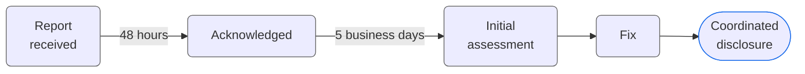

<!--suppress HtmlDeprecatedAttribute -->
<h1 align="center">Security Policy</h1>

  <h6>
    <a rel="noopener noreferrer" href="README.md">Readme</a>
    ·
    <a rel="noopener noreferrer" href="CODE_OF_CONDUCT.md">Code of Conduct</a>
    ·
    <a rel="noopener noreferrer" href="CONTRIBUTING.md">Contributing</a>
    ·
    <a rel="noopener noreferrer" href="SUPPORT.md">Support</a>
    ·
    <a rel="noopener noreferrer" href="RELEASING.md">Releasing</a>
    ·
    <a rel="noopener noreferrer" href="LICENSE.md">License</a>
  </h6>

> [!CAUTION]
> **Do not open a public issue, discussion or pull request to report a
> vulnerability.** Use the private channel below.

## Reporting a Vulnerability

Email [security@nykon.me](mailto:security@nykon.me) with the subject
`Rhumb security report`.

Please include as much of the following as you can:

- The affected package, URL or workflow
- The commit or version, and your environment (browser, OS)
- Clear reproduction steps or a minimal proof of concept
- The expected and the actual behavior
- The realistic security impact
- A suggested mitigation, if you have one

Incomplete reports are welcome, but detailed reports make triage faster.

Reports are accepted in **English**, **Ukrainian** and **Russian**.

## Scope

This policy covers the Rhumb web application, the rendering packages, the
parser, profile loading and the repository automation.

| In scope                  | Examples                                                                    |
|---------------------------|-----------------------------------------------------------------------------|
| **Rendering and export**  | Markup injection through diagram labels or profile values in the SVG output |
| **Imported data**         | Unsafe handling of imported profile JSON or saved diagrams                  |
| **Web application**       | XSS, weak security headers or CSP, service worker issues                    |
| **Repository automation** | Workflow injection, over-broad token permissions, secret exposure           |

Vulnerabilities in third-party dependencies should also be reported to their
maintainers. Only the latest release, which is what the hosted editor serves,
receives fixes.

## Response Timeline

| Stage                  | Target                         |
|------------------------|--------------------------------|
| **Acknowledgement**    | Within 48 hours                |
| **Initial assessment** | Within 5 business days         |
| **Fix and disclosure** | As soon as reasonably possible |

Timelines may vary with severity and complexity. Please give a reasonable time
to fix the issue before disclosing it publicly.

#

<h6 align="center">
  Security research helps keep Rhumb reliable and boring - 
  exactly how security should be.
</h6>
