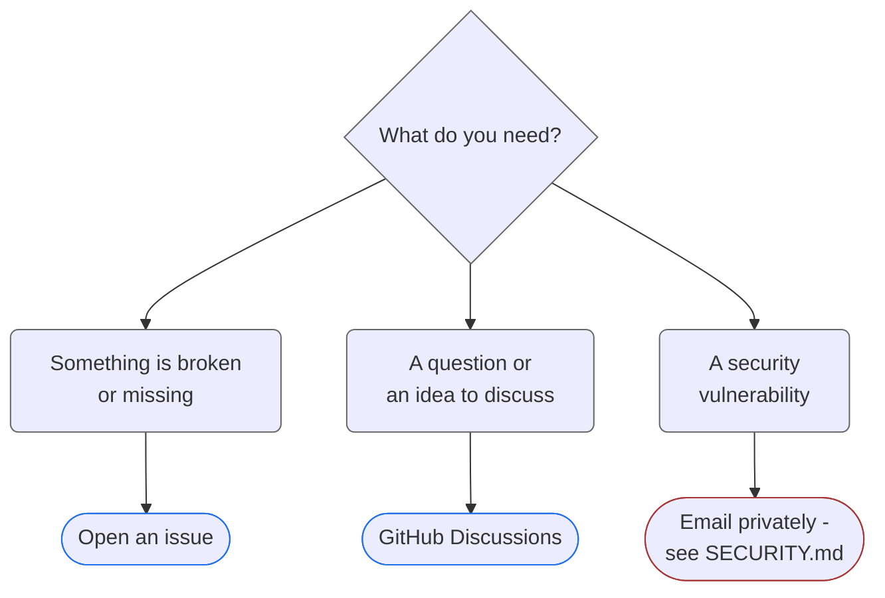

<!--suppress HtmlDeprecatedAttribute -->
<h1 align="center">Support</h1>

  <h6>
    <a rel="noopener noreferrer" href="README.md">Readme</a>
    ·
    <a rel="noopener noreferrer" href="CODE_OF_CONDUCT.md">Code of Conduct</a>
    ·
    <a rel="noopener noreferrer" href="CONTRIBUTING.md">Contributing</a>
    ·
    <a rel="noopener noreferrer" href="SECURITY.md">Security Policy</a>
    ·
    <a rel="noopener noreferrer" href="RELEASING.md">Releasing</a>
    ·
    <a rel="noopener noreferrer" href="LICENSE.md">License</a>
  </h6>

## What Kind of Support Is Available

Rhumb provides best-effort, community-driven support for:

- Reproducible bugs with clear steps
- Parser, layout and export issues
- Documentation fixes and clarifications
- Clearly scoped feature requests
- Questions about the supported source syntax and the profile format

## What Is Not Considered Support

| Not covered                       | Reason                                    |
|-----------------------------------|-------------------------------------------|
| Real-time or chat-based support   | There is no dedicated support staff       |
| Private troubleshooting           | Support is handled publicly when possible |
| Custom feature development        | Rhumb is not a consulting service         |
| SLAs or guaranteed response times | Support is best-effort                    |
| Debugging heavily modified forks  | Too many variables are involved           |

## Where to Ask for Help

| Topic                         | Channel                                                                    |
|-------------------------------|----------------------------------------------------------------------------|
| **Bugs and feature requests** | [Open an issue](https://github.com/nykonhrytsyshyn/rhumb/issues)           |
| **Questions and discussion**  | [GitHub Discussions](https://github.com/nykonhrytsyshyn/rhumb/discussions) |
| **Security vulnerabilities**  | Follow [`SECURITY.md`](SECURITY.md); do not report publicly                |

> [!TIP]
> A small reproducible example helps more than a screenshot alone. Paste the
> diagram source into the issue.

## Before Opening an Issue

> [!IMPORTANT]
> Low-effort, vague or off-topic issues may be closed without response.

- [ ] Search existing issues first
- [ ] Confirm the problem is reproducible
- [ ] Include the smallest source diagram that demonstrates it
- [ ] Include browser, OS, Node/pnpm version and the selected profile when relevant
- [ ] Include the exact error and the expected behavior

#

<h6 align="center">
  Clear reports, clear scope, clear expectations.
</h6>
