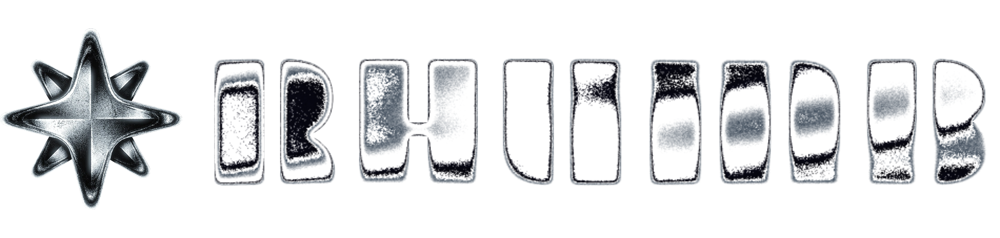

<!--suppress HtmlDeprecatedAttribute, HtmlUnknownTarget, CheckImageSize -->
<div align="center">
  <!--
  =====================
         HEADER
  =====================
  -->
  <a rel="noopener noreferrer" href="https://github.com/nykonhrytsyshyn/rhumb">
    <picture>
      <source media="(prefers-color-scheme: light)" srcset="../../.github/assets/logo/logo-text-light.png" />
      
    </picture>
  </a>
  <br />
  <!--
  =====================
         BADGES
  =====================
  -->
  <div>
    <!-- npm Badge -->
    <a rel="noopener noreferrer" href="https://www.npmjs.com/package/@nykon/rhumb-cli">
      <picture>
        <source media="(prefers-color-scheme: light)" srcset="https://img.shields.io/npm/v/@nykon/rhumb-cli?style=for-the-badge&color=363636&labelColor=464646&logo=npm&logoColor=fff" />
        
      </picture>
    </a>
    <!-- License Badge -->
    <a rel="noopener noreferrer" href="https://github.com/nykonhrytsyshyn/rhumb/blob/HEAD/LICENSE.md">
      <picture>
        <source media="(prefers-color-scheme: light)" srcset="https://img.shields.io/npm/l/@nykon/rhumb-cli?style=for-the-badge&color=363636&labelColor=464646&logo=" />
        
      </picture>
    </a>
    <!-- Node Badge -->
    <picture>
      <source media="(prefers-color-scheme: light)" srcset="https://img.shields.io/node/v/@nykon/rhumb-cli?style=for-the-badge&color=363636&labelColor=464646&logo=nodedotjs&logoColor=fff" />
      
    </picture>
  </div>
  <h1></h1>
  <!--
  =====================
         SOURCES
  =====================
  -->
  <h6>
    <a rel="noopener noreferrer" href="https://rhumb.nykon.me">Editor</a>
    ·
    <a rel="noopener noreferrer" href="https://github.com/nykonhrytsyshyn/rhumb">Repository</a>
    ·
    <a rel="noopener noreferrer" href="https://www.npmjs.com/package/@nykon/rhumb">Library</a>
    ·
    <a rel="noopener noreferrer" href="https://github.com/nykonhrytsyshyn/rhumb/issues">Issues</a>
  </h6>
</div>

<div align="justify">
  <!--
  =====================
       DESCRIPTION
  =====================
  -->
  <p>
    <b>Flowcharts by standard, from the command line.</b><br />
    Turn Mermaid-like text into standard-conforming drawings as SVG, PNG, JPEG
    or WebP, check diagrams in scripts, and give AI agents version-matched
    instructions to write them.
  </p>
</div>

<div align="center">
  <!-- Release Card -->
  <a rel="noopener noreferrer" href="https://rhumb.nykon.me">
    <picture>
      <source media="(prefers-color-scheme: light)" srcset="../../.github/assets/interactive/card-release-light.svg" />
      
    </picture>
  </a>
  <!-- Release Candidate Card -->
  <a rel="noopener noreferrer" href="https://release-candidate.rhumb.pages.dev">
    <picture>
      <source media="(prefers-color-scheme: light)" srcset="../../.github/assets/interactive/card-release-candidate-light.svg" />
      
    </picture>
  </a>
  <!-- Development Card -->
  <a rel="noopener noreferrer" href="https://dev.rhumb.pages.dev">
    <picture>
      <source media="(prefers-color-scheme: light)" srcset="../../.github/assets/interactive/card-dev-light.svg" />
      
    </picture>
  </a>
</div>

<div align="center">
  <h2 id="overview">Overview</h2>
</div>

`rhumb` is the [Rhumb editor](https://rhumb.nykon.me)'s engine as a command: the
same parser, the same standards and the same drawings, without a browser. It is
made for build scripts, documentation pipelines and AI agents that generate
flowcharts.

| Idea                      | What it means in practice                                                             |
|---------------------------|---------------------------------------------------------------------------------------|
| **Text in, drawing out**  | `rhumb render chart.rhumb -o chart.png`; the output format follows the file extension |
| **Standards as profiles** | Draw by present standards or a custom profile from a JSON file                        |
| **Strict on purpose**     | Invalid syntax is reported with its line number and a non-zero exit code              |
| **Made for scripts**      | Data on stdout, errors and warnings on stderr, `--json` output, stable exit codes     |
| **Made for AI agents**    | Version-matched syntax guides ship inside the CLI: `rhumb guide`, `rhumb skill`       |

<div align="center">
  <h2 id="install">Install</h2>
</div>

Requires Node.js `>=22.16.0`.

```bash
npm install --global @nykon/rhumb-cli
# or run it once without installing
npx @nykon/rhumb-cli render chart.rhumb -o chart.png
```

<div align="center">
  <h2 id="quick-start">Quick Start</h2>
</div>

```bash
cat > chart.rhumb <<'EOF'
flowchart TD
  start(["Start"]) --> work["x = 1"]
  work --> done(["Stop"])
EOF

rhumb check chart.rhumb                  # OK chart.rhumb: 3 blocks, 2 lines
rhumb render chart.rhumb -o chart.svg    # format follows the extension
rhumb render chart.rhumb -o chart.png --scale 3 --preset dark
cat chart.rhumb | rhumb render --profile gost-19.701-90 > chart.svg
```

<div align="center">
  <h2 id="commands">Commands</h2>
</div>

| Command            | What it does                                                               |
|--------------------|----------------------------------------------------------------------------|
| `render [file]`    | Draw a diagram as SVG, PNG, JPEG or WebP                                   |
| `check [files...]` | Validate one or more diagrams without drawing; reports the first bad line  |
| `profiles`         | List the built-in standards; `profiles show <id>` prints a profile as JSON |
| `presets`          | List the colour presets (`--json` for full values)                         |
| `guide [topic]`    | Print the instructions an AI agent needs to write Rhumb diagrams           |
| `skill`            | Print or install a `SKILL.md` that points an AI agent at this CLI          |

Input is a file path, or a diagram piped on stdin (`-` reads stdin explicitly).
Run `rhumb <command> --help` for the full option list of any command.

<h3 id="render">
  rhumb render
</h3>

| Option                            | Meaning                                                                    |
|-----------------------------------|----------------------------------------------------------------------------|
| `-o, --output <path>`             | Output file (`-` for stdout). Without it, SVG goes to stdout               |
| `--format <svg\|png\|jpeg\|webp>` | Override the format inferred from the output extension                     |
| `--profile <id>`                  | Built-in standard to draw by (`iso-5807`, `gost-19.701-90`)                |
| `--profile-file <path>`           | Load a custom standard from a JSON file                                    |
| `--preset <name>`                 | Colour preset: `print`, `paper`, `dark`, `blueprint`, `clear`              |
| `--ink`, `--fill`, `--background` | Colours for lines/text, blocks and page (override the preset)              |
| `--label-background <color>`      | Fill behind labels that sit on a line                                      |
| `--hollow`, `--transparent`       | Leave blocks see-through; drop the page background                         |
| `--padding <px>`, `--radius <px>` | Space around the drawing (`0`–`96`) and page corner radius (`0`–`48`)      |
| `--pixels-per-mm <n>`             | Drawing scale in pixels per millimetre (`4` by default)                    |
| `--scale <1-4>`                   | Pixel density for PNG, JPEG and WebP (`2` by default)                      |
| `--quality <50-100>`              | Compression quality for JPEG and WebP (`92` by default)                    |
| `--font "Name=file.ttf"`          | Load a font file; repeatable, see [Fonts](#fonts)                          |
| `--input-encoding <name>`         | Encoding of the source text; see [Encoding and Cyrillic](#encoding)        |
| `--no-xml-declaration`            | Omit `<?xml version="1.0" encoding="UTF-8"?>` from SVG output              |
| `--json`                          | Print output path, format, extension and dimensions as JSON                |

> [!TIP]
> Customize a standard: `rhumb profiles show iso-5807 > mine.json`, edit it,
> then run `rhumb render chart.rhumb --profile-file mine.json`.

Without `-o`, raster images are written to stdout only when stdout is piped or
redirected; on a terminal the command asks for `-o` instead of dumping binary
data.

<div align="center">
  <h2 id="encoding">Encoding and Cyrillic</h2>
</div>

Diagram text can be in any language. The CLI validates encodings explicitly
instead of silently turning text into gibberish:

| Where               | What happens                                                                                                                                                                   |
|---------------------|--------------------------------------------------------------------------------------------------------------------------------------------------------------------------------|
| **Input**           | UTF-8 and UTF-16 BOMs are detected automatically. Without a BOM, input must be valid UTF-8; otherwise the command exits with `2` and names the fix                             |
| **Legacy files**    | Pass `--input-encoding windows-1251` (or `utf-16le`, `koi8-u`, or any [WHATWG label](https://encoding.spec.whatwg.org/#names-and-labels))                                      |
| **SVG output**      | Always UTF-8, prefixed with `<?xml version="1.0" encoding="UTF-8"?>` so viewers do not guess. Use `--no-xml-declaration` when embedding SVG directly into HTML                 |
| **PNG, JPEG, WebP** | Text is rendered from font glyphs, so file encoding does not affect the output                                                                                                 |

> [!WARNING]
> **Windows PowerShell 5**: do not redirect or pipe text with `>` or `|`.
> `rhumb render chart.rhumb > chart.svg` re-encodes stdout through the console
> code page, and `Get-Content chart.rhumb | rhumb render` mangles non-ASCII
> input before Rhumb sees it. Pass file paths directly instead:
>
> ```powershell
> rhumb render chart.rhumb -o chart.svg
> ```
>
> PowerShell 7, Git Bash, MSYS2 and WSL do not have this issue. Existing UTF-16
> files created by PowerShell 5 redirection are read correctly.

<div align="center">
  <h2 id="fonts">Fonts</h2>
</div>

Fonts are not bundled. A profile lists the typeface stack it expects (for
example, `gost-19.701-90` asks for `OpenGost Type A`); pass the font file with
`--font` to embed and measure it:

```bash
rhumb render chart.rhumb -o chart.png \
  --profile gost-19.701-90 --font "OpenGost Type A=./OpenGost-Type-A.ttf"
```

| Where          | What happens                                                                                                                                              |
|----------------|-----------------------------------------------------------------------------------------------------------------------------------------------------------|
| **SVG**        | Embedded as a base64 `@font-face` rule so the drawing looks identical everywhere (adds the font size to the SVG). Accepts TTF, OTF, WOFF and WOFF2        |
| **Images**     | Require a **TTF or OTF** file; WOFF and WOFF2 work for SVG only                                                                                           |
| **Text width** | Measured from the file's actual glyph advance widths (TTF, OTF, WOFF and WOFF2), matching the web editor within kerning                                   |
| **Matching**   | The name before `=` must appear in the profile's font stack (`OpenGost Type A` for GOST). Unmatched fonts are skipped with a warning on stderr            |
| **No file**    | Falls back to the next installed font in the stack and estimates text width from an average glyph width                                                   |

<div align="center">
  <h2 id="ai-agents">For AI agents</h2>
</div>

Rhumb's syntax looks like Mermaid's flowchart, but it is a distinct dialect with
additional standard blocks and stricter rules. An agent guessing from general
Mermaid knowledge will hit syntax errors. The instructions live inside the CLI,
so they always match the installed parser and can be loaded selectively:

| Command               | Prints                                                                                                          | Size      |
|-----------------------|-----------------------------------------------------------------------------------------------------------------|-----------|
| `rhumb guide --short` | A concise cheat sheet                                                                                           | ~6 KB     |
| `rhumb guide <topic>` | One section: `syntax`, `blocks`, `lines`, `structure`, `pitfalls`, `workflow`, `examples` (`--list` lists them) | 3 to 8 KB |
| `rhumb guide`         | The complete reference                                                                                          | ~36 KB    |
| `rhumb skill`         | A compact `SKILL.md` pointing the agent at the commands above                                                   | ~1.3 KB   |

```bash
rhumb skill --dir ~/.claude/skills        # writes ~/.claude/skills/rhumb-diagrams/SKILL.md
rhumb check diagram.rhumb --json          # machine-readable verdict for the agent's loop
rhumb render diagram.rhumb -o diagram.png
```

<div align="center">
  <h2 id="exit-codes">Exit codes</h2>
</div>

| Code | Meaning                                                          |
|------|------------------------------------------------------------------|
| `0`  | Done                                                             |
| `1`  | Invalid diagram, or rendering failed (details on stderr)         |
| `2`  | Wrong CLI usage (unknown option, missing file, bad encoding, …)  |

<div align="center">
  <h2 id="versioning">Versioning</h2>
</div>

Calendar versions: `YY.M.N` (`26.11.3`). A new version is published only when the
CLI or the packages it is built from change, so npm version numbers have gaps
and each matches a
[GitHub release](https://github.com/nykonhrytsyshyn/rhumb/releases). The CLI
bundles `@nykon/rhumb` and has no separate dependency on it.

> [!IMPORTANT]
> Calendar versions indicate *when*, not *compatibility*. `^26.11.3` accepts
> every later release of 2026, including breaking changes, pin the exact
> version or use `~` in automation.

<h6>
  <div align="center">
    • • •
    <br /><br />
    This project is licensed under the <a rel="noopener noreferrer" href="../../LICENSE.md">MIT License</a>
    <br /><br />
  </div>
  <div align="justify">
    <ul>
      <li>Feel free to use this project for any purpose, including commercial applications.</li>
      <li>You are permitted to modify, distribute, and include this project in any form, as long as the original copyright notice is retained.</li>
      <li>If you share or publish modified versions, attribution to the original <a rel="noopener noreferrer" href="https://github.com/nykonhrytsyshyn/rhumb">GitHub repository</a> is appreciated.</li>
      <li>This software is provided "as is", without any warranties or guarantees, as detailed in the license terms.</li>
    </ul>
  </div>
</h6>
