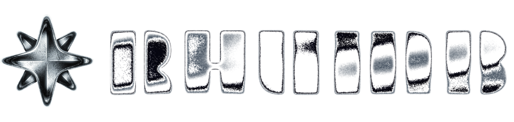

<!--suppress HtmlDeprecatedAttribute, HtmlUnknownTarget, CheckImageSize -->
<div align="center">
  <!--
  =====================
         HEADER
  =====================
  -->
  <a rel="noopener noreferrer" href="https://github.com/nykonhrytsyshyn/rhumb">
    <picture>
      <source media="(prefers-color-scheme: light)" srcset="../../.github/assets/logo/logo-text-light.png" />
      
    </picture>
  </a>
  <br />
  <!--
  =====================
         BADGES
  =====================
  -->
  <div>
    <!-- npm Badge -->
    <a rel="noopener noreferrer" href="https://www.npmjs.com/package/@nykon/rhumb">
      <picture>
        <source media="(prefers-color-scheme: light)" srcset="https://img.shields.io/npm/v/@nykon/rhumb?style=for-the-badge&color=363636&labelColor=464646&logo=npm&logoColor=fff" />
        
      </picture>
    </a>
    <!-- License Badge -->
    <a rel="noopener noreferrer" href="https://github.com/nykonhrytsyshyn/rhumb/blob/HEAD/LICENSE.md">
      <picture>
        <source media="(prefers-color-scheme: light)" srcset="https://img.shields.io/npm/l/@nykon/rhumb?style=for-the-badge&color=363636&labelColor=464646&logo=" />
        
      </picture>
    </a>
    <!-- Node Badge -->
    <picture>
      <source media="(prefers-color-scheme: light)" srcset="https://img.shields.io/node/v/@nykon/rhumb?style=for-the-badge&color=363636&labelColor=464646&logo=nodedotjs&logoColor=fff" />
      
    </picture>
    <!-- Types Badge -->
    <picture>
      <source media="(prefers-color-scheme: light)" srcset="https://img.shields.io/badge/types-included-363636?style=for-the-badge&labelColor=464646&logo=typescript&logoColor=fff" />
      
    </picture>
  </div>
  <h1></h1>
  <!--
  =====================
         SOURCES
  =====================
  -->
  <h6>
    <a rel="noopener noreferrer" href="https://rhumb.nykon.me">Editor</a>
    ·
    <a rel="noopener noreferrer" href="https://github.com/nykonhrytsyshyn/rhumb">Repository</a>
    ·
    <a rel="noopener noreferrer" href="https://www.npmjs.com/package/@nykon/rhumb-cli">Command line</a>
    ·
    <a rel="noopener noreferrer" href="https://github.com/nykonhrytsyshyn/rhumb/issues">Issues</a>
  </h6>
</div>

<div align="justify">
  <!--
  =====================
       DESCRIPTION
  =====================
  -->
  <p>
    <b>Flowcharts by standard, as code.</b><br />
    Turn Mermaid-like text into Standard-conforming drawings as SVG, PNG, JPEG
    and WebP.
  </p>
</div>

<div align="center">
  <!-- Release Card -->
  <a rel="noopener noreferrer" href="https://rhumb.nykon.me">
    <picture>
      <source media="(prefers-color-scheme: light)" srcset="../../.github/assets/interactive/card-release-light.svg" />
      
    </picture>
  </a>
  <!-- Release Candidate Card -->
  <a rel="noopener noreferrer" href="https://release-candidate.rhumb.pages.dev">
    <picture>
      <source media="(prefers-color-scheme: light)" srcset="../../.github/assets/interactive/card-release-candidate-light.svg" />
      
    </picture>
  </a>
  <!-- Development Card -->
  <a rel="noopener noreferrer" href="https://dev.rhumb.pages.dev">
    <picture>
      <source media="(prefers-color-scheme: light)" srcset="../../.github/assets/interactive/card-dev-light.svg" />
      
    </picture>
  </a>
</div>

<div align="center">
  <h2 id="overview">Overview</h2>
</div>

Mermaid is great for sketching quickly. Rhumb is built for the next step:
flowcharts that require predictable geometry, explicit block semantics and
repeatable output, the kind that goes into a thesis, specification or
engineering document. This package exposes the
[Rhumb editor](https://rhumb.nykon.me)'s engine for Node.js scripts, build
pipelines, servers, CLIs and browser apps.

| Idea                      | What it means in practice                                                              |
|---------------------------|----------------------------------------------------------------------------------------|
| **Text in, drawing out**  | One call turns Mermaid-like text into a routed, standard-conforming diagram            |
| **Standards as profiles** | Dimensions, line widths, typography and routing come from a validated JSON profile     |
| **Strict on purpose**     | Unsupported syntax is rejected with a line number instead of drawn approximately       |
| **No browser**            | SVG needs no extra runtime; images use `@resvg/resvg-js`, with no DOM anywhere         |
| **Typed**                 | Ships its own TypeScript declarations; ESM only                                        |

<div align="center">
  <h2 id="install">Install</h2>
</div>

Requires Node.js `>=22.16.0` (ESM only).

```bash
npm install @nykon/rhumb
```

Raster image rendering uses optional peer dependencies, install only what you
need:

| Output format                 | Extra packages                      |
|-------------------------------|-------------------------------------|
| SVG                           | None                                |
| PNG                           | `npm install @resvg/resvg-js`       |
| JPEG or WebP (also needs PNG) | `npm install @resvg/resvg-js sharp` |

If a required dependency is missing, `renderImage` throws a
`MissingDependencyError` with the exact installation command.

<div align="center">
  <h2 id="usage">Usage</h2>
</div>

```ts
import { writeFile } from "node:fs/promises";
import { check, render, renderImage } from "@nykon/rhumb/node";

const source = `flowchart TD
  start(["Start"]) --> work["x = 1"]
  work --> done(["Stop"])`;

// Render SVG
const { svg, size } = await render(source, {
  profile: "gost-19.701-90",
  preset: "dark",
  padding: 16,
});

// Render PNG, JPEG or WebP
const image = await renderImage(source, { format: "png", scale: 2 });
await writeFile("chart.png", await image.bytes());

// Validate without rendering
check("flowchart TD\n  a -->"); // { ok: false, line: 2, message: "..." }
check(source);                  // { ok: true, nodes: 3, edges: 2 }
```

To reuse one instance across multiple diagrams, or to register custom profiles
and fonts, create a renderer with `createRhumb`:

```ts
import { createRhumb } from "@nykon/rhumb/node";

const rhumb = createRhumb();

rhumb.profiles();                                       // list built-in standards
rhumb.registerProfile(JSON.parse(profileJson));         // register a custom profile
await rhumb.render(source, { profile: "my-standard" }); // render with it
```

<h3 id="errors">
  Errors
</h3>

`check` never throws on invalid diagram syntax; it returns `{ ok: false, line, message }`.
`render`, `renderImage` and `registerProfile` throw typed errors:

| Error                    | When it is thrown                                                  |
|--------------------------|--------------------------------------------------------------------|
| `DiagramSyntaxError`     | Invalid diagram source (`.line` holds the 1-based line number)     |
| `ExportOptionError`      | Option out of range or invalid (`.field` names the option)         |
| `InvalidProfileError`    | Profile JSON fails schema validation (`.issues` lists the reasons) |
| `MissingDependencyError` | `@resvg/resvg-js` or `sharp` is missing (`.packageName`)           |
| `RangeError`             | Raster dimensions exceed the canvas limit                          |

<div align="center">
  <h2 id="options">Options</h2>
</div>

Every option is optional, and all `render` options work in `renderImage`:

| Option            | Meaning                                                                                                  |
|-------------------|----------------------------------------------------------------------------------------------------------|
| `profile`         | Profile object or registered id (`"iso-5807"`, `"gost-19.701-90"`). Uses the default profile if omitted  |
| `preset`          | Colour preset to start from: `print`, `paper`, `dark`, `blueprint`, `clear`                              |
| `ink`, `fill`     | Colours for lines/text and for blocks (override the preset)                                              |
| `hollow`          | Leave blocks see-through instead of filling them                                                         |
| `background`      | Page background colour                                                                                   |
| `transparent`     | Drop the page background                                                                                 |
| `labelBackground` | Fill behind labels that sit on a line (follows the page by default)                                      |
| `padding`         | Free space around the drawing in pixels, `0`–`96` (`0` by default)                                       |
| `radius`          | Page corner radius in pixels, `0`–`48` (`0` by default)                                                  |
| `pixelsPerMm`     | Drawing scale in pixels per millimetre of the profile (`4` by default)                                   |
| `fonts`           | Font files for this drawing; see [Fonts](#fonts)                                                         |
| `format`          | `renderImage` only: `png` (default), `jpeg` or `webp`                                                    |
| `scale`           | `renderImage` only: pixel density `1`–`4` (`2` by default)                                               |
| `quality`         | `renderImage` only: encoder quality `50`–`100` for JPEG and WebP (`92` by default)                       |

<div align="center">
  <h2 id="fonts">Fonts</h2>
</div>

Fonts are **not** bundled. A profile specifies a font stack (for example,
`gost-19.701-90` requests `OpenGost Type A`); pass font files via `loadFont` or
`FontSource` objects (`{ family, data, format?, weight? }`) so Rhumb can
measure and embed them:

```ts
import { createRhumb, loadFont } from "@nykon/rhumb/node";

const rhumb = createRhumb({
  fonts: [await loadFont("OpenGost Type A", "./fonts/OpenGost-Type-A.ttf")],
});

const image = await rhumb.renderImage(source, { profile: "gost-19.701-90" });
```

| Aspect         | Behaviour                                                                                                                                  |
|----------------|--------------------------------------------------------------------------------------------------------------------------------------------|
| **Matching**   | A font is used only when the profile's font stack names its `family` (case-insensitive)                                                    |
| **SVG**        | Embedded as base64 `@font-face` so the drawing renders consistently everywhere (adds the font size to the SVG)                             |
| **Images**     | Require a **TTF or OTF** file; WOFF and WOFF2 work in SVG but throw an error in `renderImage`                                              |
| **Text width** | Measured from real glyph advance widths (TTF, OTF, WOFF and WOFF2), matching the web editor within kerning                                 |
| **No file**    | Falls back to the next installed font in the stack and estimates text width from an average glyph width                                    |

> [!NOTE]
> Pass a custom `measurer` (`TextMeasurer`) to `createRhumb` to override text
> measurement.

<div align="center">
  <h2 id="environments">Other environments</h2>
</div>

`@nykon/rhumb/node` is preconfigured for Node.js. The root entry `@nykon/rhumb`
contains **no platform code** (no filesystem, no Node APIs, no DOM), so you can
wire `Rhumb` with the parts of your own environment, the
[Rhumb editor](https://rhumb.nykon.me) uses it this way in the browser:

```ts
import { ElkLayoutEngine, Rhumb } from "@nykon/rhumb";

const rhumb = new Rhumb({
  layoutEngine: new ElkLayoutEngine(elk),             // any elkjs instance
  measurer,                                           // optional: custom TextMeasurer
  createRasterizer: ({ matte, fonts }) => rasterizer, // optional: needed for renderImage
});
```

| Entry point         | Exports                                                                                   |
|---------------------|-------------------------------------------------------------------------------------------|
| `@nykon/rhumb/node` | `createRhumb`, `render`, `renderImage`, `check`, `loadFont`, `NodeRasterizer`, plus below |
| `@nykon/rhumb`      | `Rhumb`, `ElkLayoutEngine`, `ProfileRegistry`, `export*` helpers, error classes and types |

<div align="center">
  <h2 id="versioning">Versioning</h2>
</div>

Calendar versions: `YY.M.N` (`26.11.3`). A new version is published only when the
library changes, so npm version numbers have gaps and each matches a
[GitHub release](https://github.com/nykonhrytsyshyn/rhumb/releases).

> [!IMPORTANT]
> Calendar versions indicate *when*, not *compatibility*. `^26.11.3` accepts
> every later release of 2026, including breaking changes, pin the exact
> version or use `~` in production. Breaking changes are listed in the release
> notes.

<div align="center">
  <h2 id="related">Related</h2>
</div>

| Project                                                              | What it is                                                        |
|----------------------------------------------------------------------|-------------------------------------------------------------------|
| [Rhumb editor](https://rhumb.nykon.me)                               | Web editor: write, preview and export diagrams in the browser     |
| [`@nykon/rhumb-cli`](https://www.npmjs.com/package/@nykon/rhumb-cli) | Command-line tool for scripts, CI and AI agents                   |
| [Source repository](https://github.com/nykonhrytsyshyn/rhumb)        | Monorepo, issues and release notes                                |

<h6>
  <div align="center">
    • • •
    <br /><br />
    This project is licensed under the <a rel="noopener noreferrer" href="../../LICENSE.md">MIT License</a>
    <br /><br />
  </div>
  <div align="justify">
    <ul>
      <li>Feel free to use this project for any purpose, including commercial applications.</li>
      <li>You are permitted to modify, distribute, and include this project in any form, as long as the original copyright notice is retained.</li>
      <li>If you share or publish modified versions, attribution to the original <a rel="noopener noreferrer" href="https://github.com/nykonhrytsyshyn/rhumb">GitHub repository</a> is appreciated.</li>
      <li>This software is provided "as is", without any warranties or guarantees, as detailed in the license terms.</li>
    </ul>
  </div>
</h6>
